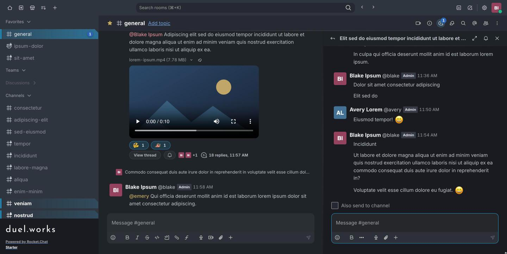

# DuelWorks Rocket.Chat style

A custom stylesheet that makes the DuelWorks Rocket.Chat web client easier to read: clearer unread rooms, pill-shaped buttons and reactions, roomier and more evenly spaced messages, filled rounded fields, softer surfaces instead of hard divider lines, and the duel.works wordmark in the sidebar.

## Install

1. Copy the contents of [`custom.css`](custom.css).
2. In Rocket.Chat, go to **Administration → Workspace → Settings → Layout → Custom CSS**.
3. Replace everything in the box with the copied CSS, then **Save**.
4. Reload the page (⌘R / Ctrl-R).

## Notes

- Applies to the web client and desktop app. The native iOS/Android apps ignore custom CSS.
- Colors, sizes and spacing are tunable in the `:root` block at the top of `custom.css`.
- Working on the stylesheet? Start with [`AGENTS.md`](AGENTS.md) (workflow, Rocket.Chat quirks, design rules). [`tools/cc-helpers.js`](tools/cc-helpers.js) has the in-browser test helpers.
